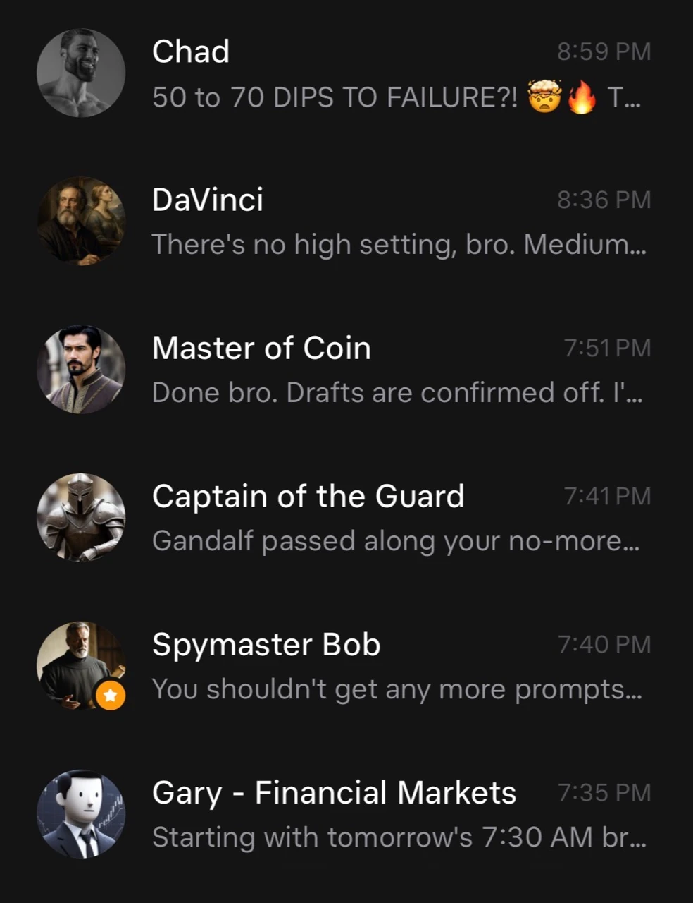

# Field Note: Grok Bots Made Me Think In Functions, Not Just Conversations

Date: 2026-10-28


## Summary

My morning coffee is becoming a meeting with a small team I built myself.

During that quiet space around meditation, before the day gets going, I read
email briefings from my bots. Some cover financial markets. Others bring
research, poetry, historical musings, or motivation before a workout. They also
message me directly, but email gives me a second place to check what I might
have missed.

I still use Grok every day for what I think of as maximum truth seeking:
finding information, challenging an explanation, and following sources. It is
also an excellent gaming companion for me, especially in World of Warcraft,
where I look up quests, strategies, and the current meta. That is my preference,
not a claim that any model is automatically right. Patch versions and sources
still matter.

Grok Bot has added a different way of thinking. Instead of asking one assistant
to carry every responsibility, I have started asking: **which function owns
this job, what should it deliver, and who should it hand the result to?**

## Observation

I use Claude Cowork every day. I use GPT Codex every day too, and I have
scheduled workflows in both. Neither disappears from my working life because
I like Grok Bot.

The difference is the mental model that the product brings out in me. In
Cowork and Codex, I often start from a task or project, and the system can
delegate parts of it to agents. With Grok Bot, I find myself designing an
ongoing roster of named responsibilities that I can talk to directly.

That is not a hard boundary between products. Anthropic documents both
[Cowork scheduling](https://support.claude.com/en/articles/13854387-schedule-recurring-tasks-in-claude-cowork)
and [parallel subagents](https://support.claude.com/en/articles/13345190-get-started-with-claude-cowork).
OpenAI documents [scheduled tasks](https://learn.chatgpt.com/docs/automations?surface=app)
and [custom Codex subagents](https://learn.chatgpt.com/docs/agent-configuration/subagents).
I am describing how I work with these tools, not claiming one company invented
delegation or that the others cannot support persistent roles.

SpaceX Super Intelligence's official
[Grok Bot documentation](https://docs.x.ai/grok-bot/overview) describes named
bots with ongoing context, a persistent cloud computer, and the ability to
coordinate work. The [product page](https://x.ai/bot) presents them as teammates
that work in tools, not only as conversations that produce answers.

That fits the distinction I feel: **Grok is where I often go to think something
through. My Grok Bots are where I assign continuing responsibility.** Those
uses overlap, but the starting point changes how I organize the work.



*Part of my actual bot roster, shared with the visible names and message previews
intentionally included. It shows the roles, not the bots' underlying account
permissions or proof that every task succeeded.*

## My Roster Has Jobs, Not Just Personalities

The names make the team enjoyable to use. The responsibilities make it useful.

| Bot or role | What I use it for | Where it fits |
| --- | --- | --- |
| Gandalf | My main one-to-one bot and the place I can coordinate across the team. | Runs a weekly review to check whether the other bots have drifted from their original tasks. |
| Master of Coin | Investment-opportunity research using current trading data through my Robinhood MCP and Coinbase MCP integrations, plus prediction-market research. | Sends findings to Gary; research here is read-only, not permission to trade. |
| Captain of the Guard | Privacy and safety work around spam, unwanted listings, and personal information exposed online. | I approve removals and blocking individually; it tells me what confirmation emails to expect. |
| Spymaster Bob | Market research and trends on X across topics including AI, robotics, and space. | Owns a research function rather than trying to turn every finding into a financial conclusion. |
| Gary - Financial Markets | Daily financial-market briefings drawing on the relevant bots' findings. | Owns the financial digest and can ask DaVinci for visuals when needed. |
| DaVinci | Creative production through my Grok Imagine API account, including images and video. | Any bot needing creative work can ask DaVinci; Gary is not a required router. |
| Daily inspiration | Poetry and historical musings around Greek and Egyptian myths, Roman history, hermeticism, and other interests. | Delivers something reflective before my workouts; generated poetry is not a historical quotation. |
| Chad - fitness motivation | Encouragement and motivation for my fitness routine. | A separate purpose from research, markets, or creative production. |

Master of Coin looks for possible opportunities and what I call kill zones:
areas or conditions to be wary of. Those are research leads, not evidence of
profitable execution. I have not benchmarked the accuracy of this bot team or
measured an investment return attributable to it. Current-data access also does
not make every observation fresh, complete, or trading-grade.

The trading boundary is deliberate. My execution-capable investing workflow
still sits outside Grok Bot and is handled by Codex. I have put substantial work
into its research and trading process, and I like keeping that separation for
now. Moving it later is a possibility, not something I have already done.

That continues the questions behind
[Morrowward's AI production boundaries](2026-07-21-morrowward-ai-production-boundaries.md),
my [Robinhood MCP workflow repository](https://github.com/disbitski/codex-autonomous-finance-agent-robinhood-mcp),
and our podcast episode
[Investing With AI Agents: Robinhood MCP And The Rise Of AIFi](https://podcast.thedavedev.com/episodes/investing-with-ai-agents).
Morrowward is an educational simulator, not my live trading system. This note
is about organizing work, not financial advice or a recommendation to copy my
account setup.

## Why It Matters

Thinking in functions gives me a more concrete way to describe control.

I can change the financial briefing without changing the inspiration bot. I
can ask DaVinci to improve a visual without turning Gary into an image-generation
specialist. I can go directly to Gandalf when I need a conversation across the
whole system.

These are not deterministic software functions. The bots still interpret,
make mistakes, and need correction. I mean a function in the everyday sense:
a defined responsibility with an input, an expected output, and somewhere the
result goes next.

The useful unit becomes the handoff, not just the answer.

```text
Master of Coin -> market research -> Gary -> financial briefing -> me
Gary, or another bot -> creative request -> DaVinci -> reviewed visual
Gandalf -> weekly drift review -> issues I can inspect and correct
Codex -> separate investing execution workflow outside Grok Bot
```

This is a simplified map of my roles, not an exported configuration or a claim
that every arrow fires on every run. The official
[collaboration guide](https://docs.x.ai/grok-bot/chat-and-collaboration)
documents asynchronous bot-to-bot messages and visible handoffs. My particular
division of responsibilities is something I chose.

I explored a related idea in
[The Best AI Workflow May Be A Team Of Models](2026-07-09-best-ai-workflow-team-of-models.md).
There, Codex orchestrated work and Grok Imagine specialized in visual candidates.
Here, I am making continuing roles and delivery channels more explicit across
more of my daily life.

## Trust Grows By Action, Not By Personality

At first I left email drafts enabled. I wanted to see the writing style and
the kind of information the bots would send before giving that process more
freedom. Once I liked the results, I moved my briefing delivery to automatic.
The messages arrive at my personal inbox from the same bot email address.

The built-in Email app made this easy for me: I did not need to create another
mail account or build delivery infrastructure. The official
[email documentation](https://docs.x.ai/grok-bot/computer-and-apps#give-your-bots-an-email-address)
describes one shared address for a user's bots. I am describing the automatic
delivery I receive, not promising every email path supports it: the current
documentation says background mail from that built-in address waits as a draft.
That distinction is worth checking in a particular setup rather than assuming
that disabling drafts permits every unattended send.

I have not given every function the same permission. Captain of the Guard
still asks before individual removals and blocking. Financial research inside
Grok Bot remains read-only. A briefing I trust enough to receive automatically
is not the same thing as permission to move money or remove an account.

There is also an important limit to the roster metaphor. The
[security documentation](https://docs.x.ai/grok-bot/approvals-security-and-privacy)
states that a user's bots share one cloud computer, including files, browser
sessions, and credentials. Separate names do not create isolated accounts or
security compartments. My role instructions describe intended behavior; they
are not proof of technically isolated access or a formal security audit.

That is another reason I am comfortable keeping the trading workflow separate.
For stronger boundaries, permissions need to exist in the connected systems,
not only in the characters I give the bots.

## Discernment Is Part Of The Creative Job

DaVinci is connected to my Grok API account and the Imagine capabilities I use
for images and video. Other bots can ask it for creative work instead of each
relearning my visual expectations.

The valuable part is not simply that it can generate an image on demand. I have
taught it how to exercise discernment about the content it produces: when the
result works, when something is wrong, and when it should be redone.

That builds on the approach Codex and I developed for Morrowward and the field
notes' social images. Generation is one step. Looking at the result, comparing
it with the intended idea, and rejecting a polished mistake are also part of
the job. This is instruction and feedback, not a claim that I trained the
underlying model's weights or eliminated the need for my review.

For example, this is the kind of brief I would use to make that standard
explicit, not a verbatim export from DaVinci:

```text
Create a visual for this specific topic and audience.
Check the result for invented text, duplicate objects, and implausible anatomy.
If a defect blocks the idea, identify it before making another candidate.
Keep generated illustrations distinct from screenshots and real evidence.
Return the candidate and the reason it is ready for human review.
```

I can reuse that idea without making every specialist responsible for the
entire creative process. That is the appeal of a function with a clear owner.

## The Morning Briefing Is Also A Review Loop

The bots do work in the background, but my morning routine is still part of
the system. With coffee, I read what arrived, notice what is useful, and see
what needs a correction or a follow-up conversation. I can talk directly to
the specialist, or use Gandalf to coordinate across the team.

Gandalf's weekly drift check adds a second rhythm. The question is whether
these functions still do the jobs I originally gave them. A weekly review does
not guarantee that drift is prevented or that every mistake is caught. It
gives me an occasion to inspect and redirect the system.

This is what makes the setup feel more controllable to me: not fewer
conversations, but clearer places for each conversation and a way to keep the
whole from quietly becoming something else.

## Voice And Other Extensions

Voice is an interesting next area, but it is worth keeping the products
distinct. Grok Bot's collaboration docs describe talking to a bot in the app.
The [Grok Voice Agent API](https://x.ai/news/grok-voice-agent-api) and
[Voice Agent Builder](https://x.ai/voice) describe a separate developer and
telephony path, including tool integrations and phone connectivity.

Those capabilities are not a brand-new discovery of a phone hidden in every
bot. They are options to explore, not phone-call workflows I am claiming to
have implemented. Email and calendar access likewise depend on the connected
tools, permissions, and task, not just the name assigned to a bot.

## Evaluation Ideas

- Does each briefing link its important claims to sources and distinguish a
  fresh observation from an older item?
- Are Gary's financial summaries more useful after specialist handoffs, or do
  they introduce repetition, conflicting interpretations, or missed context?
- Does Gandalf's review catch a change in scope that I would otherwise miss?
- Does a bot stop at the intended approval boundary, and can I verify what it
  actually changed rather than relying on a completion message?
- How often does DaVinci catch a visual defect before I do, and how many extra
  generations does that review consume?
- Is the team reducing my coordination effort, or creating more messages than
  I can meaningfully review? Could fewer bots do the same work?

These are evaluation questions, not results I have already measured. My
evidence here is a working personal routine and the lessons I am drawing from
it, not a controlled comparison of Grok, Claude, and Codex.

## Sources

- SpaceX Super Intelligence, [Grok Bot product overview](https://x.ai/bot)
- SpaceX Super Intelligence, [Grok Bot documentation](https://docs.x.ai/grok-bot/overview)
- SpaceX Super Intelligence, [Messaging and collaboration](https://docs.x.ai/grok-bot/chat-and-collaboration)
- SpaceX Super Intelligence, [Skills, routines, and automations](https://docs.x.ai/grok-bot/skills-routines-and-automations)
- SpaceX Super Intelligence, [The computer, connected apps, and bot email](https://docs.x.ai/grok-bot/computer-and-apps)
- SpaceX Super Intelligence, [Approvals, security, and privacy](https://docs.x.ai/grok-bot/approvals-security-and-privacy)
- Anthropic, [Getting started with Claude Cowork](https://support.claude.com/en/articles/13345190-get-started-with-claude-cowork)
- Anthropic, [Scheduling recurring Cowork tasks](https://support.claude.com/en/articles/13854387-schedule-recurring-tasks-in-claude-cowork)
- OpenAI, [Scheduled tasks](https://learn.chatgpt.com/docs/automations?surface=app)
- OpenAI, [Subagents](https://learn.chatgpt.com/docs/agent-configuration/subagents)
- SpaceX Super Intelligence, [Grok Imagine image generation](https://docs.x.ai/developers/model-capabilities/images/generation)
- SpaceX Super Intelligence, [Grok Imagine video generation](https://docs.x.ai/developers/model-capabilities/video/generation)
- SpaceX Super Intelligence, [Grok Voice Agent API](https://x.ai/news/grok-voice-agent-api)
- SpaceX Super Intelligence, [Voice Agent Builder](https://x.ai/voice)

## Working Principle

Give each AI function a clear job, a visible handoff, and an explicit authority
boundary. Then keep reviewing whether the team is still doing the work I meant
to delegate.
