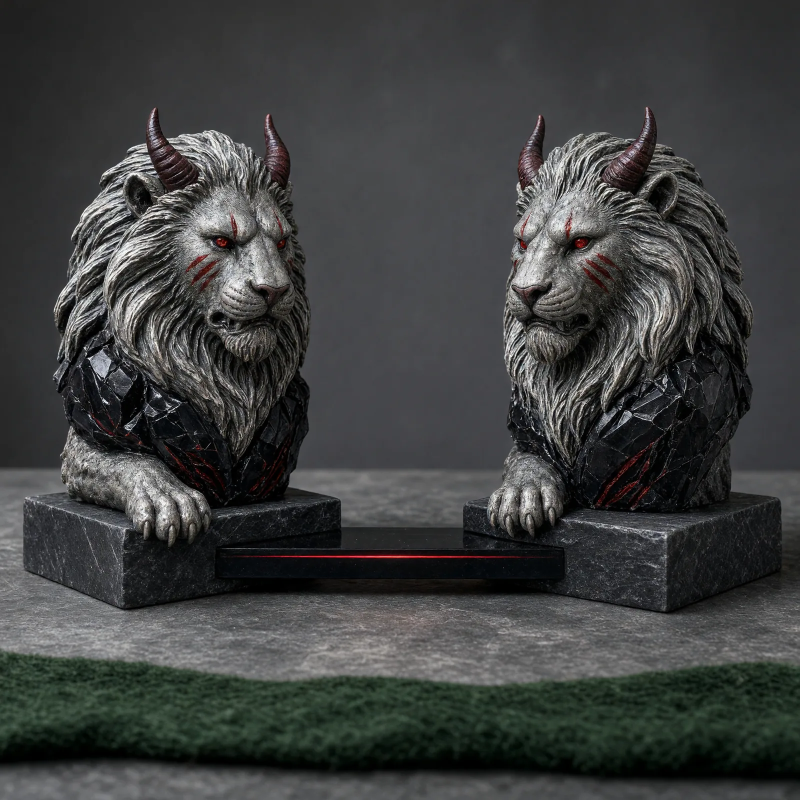
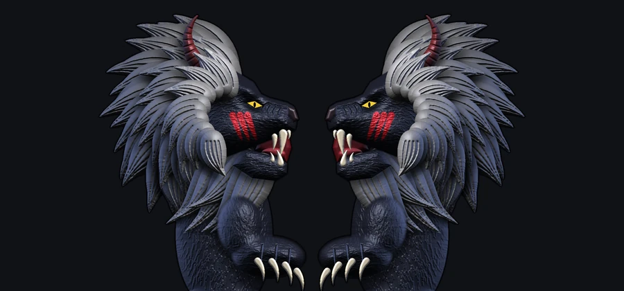
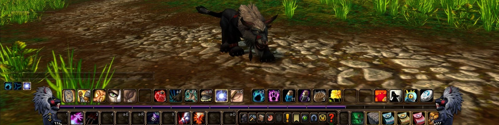
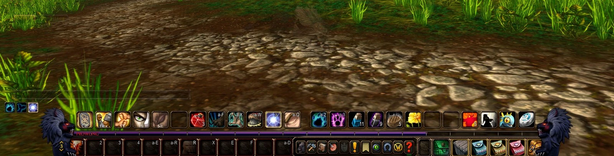

# Field Note: Building ShadowProwl With Claude: A Stealth Bar With A Story

Date: 2026-11-15



<!-- podcast-links:start -->
## Listen To This Field Note

This field note is also available as **Season 1, Episode 12** of *The Age We Build*.

- [Listen on the Web](https://podcast.thedavedev.com/episodes/shadowprowl-claude-cowork)
- [Listen on Apple Podcasts](https://podcasts.apple.com/us/podcast/building-shadowprowl-with-claude-a-stealth-bar-with-a-story/id6796456206?i=1000802126787)
<!-- podcast-links:end -->

*Editorial illustration inspired by ShadowProwl's Watchers. The original addon
artwork and actual gameplay captures appear below.*

## Summary

I love World of Warcraft. It is not only a game to play through; it is a world
I enjoy spending time in, with characters and routines that become my own.
World of Warcraft: Forever has given me another reason to explore that
relationship between an existing world and what I can bring to it.

This time I built something for my feral druid with **Claude Opus 5.5 High and
Cowork**: [ShadowProwl](https://github.com/disbitski/ShadowProwl), an addon that
gives Prowl a dedicated stealth action bar, a shadowed visual treatment, and
two black-lion guardians whose eyes wake up when I disappear into stealth.

The practical feature and the character lore grew together. Claude and I
iterated on the graphics, the statues, and the story behind them, then took
the result into actual gameplay. We were not building a replacement for WoW.
We were making a small part of a game I already love feel more useful and
more personal.

It is a very tangible version of my earlier field note,
[AI Is A Collaboration Layer, Not A Replacement Worker](https://github.com/disbitski/real-world-ai-lab/blob/main/field-notes/2026-06-18-human-ai-interaction.md).
The AI helped me build; it did not replace the player, the character, or the
judgment about what belonged in that world.

## Observation

The gameplay need was specific. I wanted my main action bar to show one set
of abilities while prowling and return to my normal cat bar when stealth
ended, without making me relearn my keybinds.

The default druid setup I was using did not provide that dedicated Prowl
page. This was not a new spell or a change to Blizzard's combat rules. It
was a way to organize and present the abilities I already had.

I pointed Claude at existing WoW addons so it could learn from working
examples. Importantly, I did that inside a separate directory it had access
to, rather than turn my live WoW game folder into its development workspace.
The examples supplied context; the isolated workspace gave us room to build
without treating the installation I play in as a scratch directory.

From there, the work became a back-and-forth between human intent and AI
execution. Claude could help write the Lua and design the graphics assets.
I could judge whether the result felt right for my character and whether
it actually worked when I played.

## Why Forever Was Such A Good Moment For This

The enthusiasm around Forever is not only my own. Blizzard's
[official launch-record announcement](https://bsky.app/profile/worldofwarcraft.blizzard.com/post/3mzoudcfxws2t)
describes it as WoW's largest launch by peak concurrent players, with a
record number of returning players. Holly Longdale also
[reported the strongest new-player turnout for a WoW launch in 15 years](https://x.com/TheWindstalker/status/2118894053094035457).

Blizzard shared some striking concrete numbers too:
[3,924 virtual machines, 251,136 GB of memory, and 70,480 CPU cores](https://x.com/Warcraft/status/2118171078912618887).
Those describe the infrastructure, not the number of people playing. The
launch-record announcement itself does not give an exact concurrent-player
or returning-player count.

For me, that is an exciting setting for a small creative project: a familiar
world attracting people back, and an opportunity to make my own corner of it
feel a little more like mine.

## Give The AI Context Without Giving It The Whole Game Folder

The workspace boundary was part of the workflow, not an afterthought.
I wanted Claude to inspect useful examples and create an addon, not freely
rearrange my installed addons or game files.

The pattern is easy to adapt. An illustrative layout, not my exact folder
names, looks like this:

```text
addon-workspace/             <- folder connected to Cowork
  reference-addons/          <- copies of useful examples
  ShadowProwl/               <- the addon under development

WoW/Interface/AddOns/        <- live installation, outside this workspace
```

[Anthropic's Cowork guide](https://claude.com/resources/guides/claude-cowork-product-guide/getting-started)
explains connecting folders explicitly. The important decision in my setup
was which folder to connect. A separate workspace reduces the files exposed
to ordinary development work; it is not a claim that a folder name alone
creates an impenetrable security boundary.

This is the same practical lesson behind my
[agent-harness field note](https://github.com/disbitski/real-world-ai-lab/blob/main/field-notes/2026-06-20-agent-harnesses.md):
the model needs the right examples and room to act, but the environment
still needs deliberate limits.

## The Watchers Were More Than Decoration

We did not stop at getting the buttons to swap.



*The Watchers of the Dusk Trail, from the actual ShadowProwl project. Their
story became part of how the interface behaves.*

Claude was able to design the in-game graphics assets, and we iterated
back and forth on what they should become. We settled on dark lion statues
with silver manes, horns, and red war-paint markings, tied to the identity
of my druid rather than a generic UI theme.

The project's original character lore gives them a name: **the Watchers of
the Dusk Trail**. Shadowmane is the ancient hunting spirit in the story;
the Watchers are the guardians carved to accompany the hunt. These are our
own additions around my character, not official Blizzard lore.

That story became visible behavior. Outside stealth, the statues keep
their vigil. When I Prowl, the bar darkens, crimson accents pulse, and their
eyes glow red. The guardians wake up at the same moment the stealth page
takes over.



*Outside stealth: the normal action page and the Watchers at rest.*



*During Prowl: the dedicated page and its shadow treatment. These are actual
gameplay captures from the repository, not generated mockups.*

What I like is that the visual idea and the practical idea reinforce each
other. The change is not only a prettier border. It tells me that I am in a
different state, with a different set of actions under the same keys.

## The Important Part Was What Happened When Stealth Broke

A stealth bar that looks good but stays on the wrong page when an opener
starts combat would miss the point.

The [implementation](https://github.com/disbitski/ShadowProwl/blob/be8727ca1672911c4146107081668b28cc53fd5a/Core.lua)
uses a secure state handler for the main action buttons. While the stealth
condition is active, it assigns the selected action page. When the condition
ends, it clears that override so Blizzard's normal paging can take over.
The visual effects follow the state change separately.

The feature is designed to return to the normal bar even when leaving
stealth puts me into combat. The code also defers protected configuration
changes until combat ends. Those are different jobs: responding to an
already registered state transition is not the same as freely rebuilding
the action bar during combat.

We did gameplay testing and used that feedback to iterate. The finished
result was a dedicated Prowl hotbar setup with both functional and visual
changes, not just a static concept image. That does not mean every addon
combination or future client update has been tested.

The scope is deliberately small. ShadowProwl targets Forever's default
main action bar. Its documentation calls out the shared slots used by the
default stealth page and does not claim support for action-bar replacements
such as Bartender, Dominos, or ElvUI's bars.

For example, the existing preview and configuration commands are:

```text
/sprowl test
/sprowl page 3
/sprowl status
```

The first previews the visual treatment for six seconds without swapping
the action page. The other commands choose the page and inspect settings.
The repository explains how to populate that page and which existing bar
slots it shares.

## The 4Ds In A Small Addon

Looking back at this build, I recognize the pattern I explored in
[The 4D Framework Is A Common Language For AI Collaboration](https://github.com/disbitski/real-world-ai-lab/blob/main/field-notes/2026-06-28-4d-framework-common-language.md).
Rick Dakan and Joseph Feller's AI Fluency framework, developed with Anthropic,
gives me a useful way to explain the work:

| Competency | What it looked like with ShadowProwl |
| --- | --- |
| Delegation | I supplied the gameplay need, character context, creative direction, and final judgment. Claude helped implement the addon and produce its graphics; we shaped the lore and visuals together. |
| Description | I gave Claude existing addons to learn from, explained the Prowl behavior I wanted, and refined the visual direction as we went. |
| Discernment | I judged the statues and lore against my character, then used actual gameplay to evaluate the interface rather than accept a plausible-looking image or code sample. |
| Diligence | I kept development separate from my game installation, tested the result, and am explicit about Claude's contribution and which lore is our own. |

Delegation is the division of work. The
[Description-Discernment Loop](https://www.anthropic.com/ai-fluency/description-discernment-loop)
is what happened inside that collaboration: explain what I wanted, examine
what came back, and refine the next pass through artwork review and play.

That is the same distinction I made in
[The Loop That Built Morrowward](https://github.com/disbitski/real-world-ai-lab/blob/main/field-notes/2026-07-21-morrowward-delegation-discernment-loop.md).
Here the subject was a feral druid rather than an educational investing app,
but my role was still active throughout. The feedback was part of building,
not a ceremonial approval after the AI had finished everything.

## Why It Matters

When I talk about AI and games, it is easy to jump straight to generating
an entire world or having an agent play the game. This experience points
to another possibility: helping players build thoughtful extensions to
the games they already love.

The AI was in the creation process. ShadowProwl itself is Lua and graphics
assets responding to game state, not a model deciding which ability I
should cast. I am still the player.

What changed was my ability to work across several disciplines in one
collaboration: a gameplay requirement, existing addon examples, interface
code, graphics, character lore, and feedback from playing. Human taste
was not the last approval step after the real work. It helped determine
what we were building throughout.

That connects with my
[Blender and Embermere experience](https://github.com/disbitski/real-world-ai-lab/blob/main/field-notes/2026-07-14-amiga-blender-mcp-embermere.md).
There is something valuable about turning a personal creative idea into an
asset I can actually use. Here, the place I could use it was already a
world I loved visiting.

I see room for more of this: small, expressive additions that make existing
games more personal, legible, or enjoyable, where the game's extension
interfaces allow it. Not every improvement needs to become a new game.

## Evaluation Ideas

For another pass, I would judge the addon through observable play rather
than how convincing the generated code sounds:

- Does entering and leaving Prowl select the expected actions under the same
  keys, including when an opener starts combat?
- Does normal Cat and Bear paging resume correctly, and do vehicle or
  override bars take priority?
- Do shadow, contrast, and eye effects communicate stealth clearly without
  making cooldowns or ability icons harder to read?
- Does the chosen page avoid unintended conflicts with other visible bars?
- Do configuration changes, reloads, and future client updates preserve the
  intended behavior?
- Does the lore make the interface feel more like my character, while the
  actual gameplay remains the deciding test?

These are follow-up checks, not a claim that I ran a comprehensive automated
compatibility suite or measured a combat-performance improvement.

## Sources

- [ShadowProwl source, setup, screenshots, and original character lore](https://github.com/disbitski/ShadowProwl)
- [ShadowProwl implementation reviewed for this note](https://github.com/disbitski/ShadowProwl/blob/be8727ca1672911c4146107081668b28cc53fd5a/Core.lua)
- [ShadowProwl changelog](https://github.com/disbitski/ShadowProwl/blob/be8727ca1672911c4146107081668b28cc53fd5a/CHANGELOG.md)
- Blizzard, [Forever launch records](https://bsky.app/profile/worldofwarcraft.blizzard.com/post/3mzoudcfxws2t)
- Blizzard, [Forever launch infrastructure](https://x.com/Warcraft/status/2118171078912618887)
- Holly Longdale, [New-player turnout](https://x.com/TheWindstalker/status/2118894053094035457)
- Anthropic, [Getting started with Claude Cowork](https://claude.com/resources/guides/claude-cowork-product-guide/getting-started)
- Rick Dakan, Joseph Feller, and Anthropic, [The AI Fluency Framework](https://www-cdn.anthropic.com/334975cdec18f744b4fa511dc8518bd8d119d29d.pdf)
- Anthropic, [The Description-Discernment Loop](https://www.anthropic.com/ai-fluency/description-discernment-loop)

## Working Principle

Use AI to help build the personal touches an existing game is missing, and
let human taste and actual play decide whether they belong.
